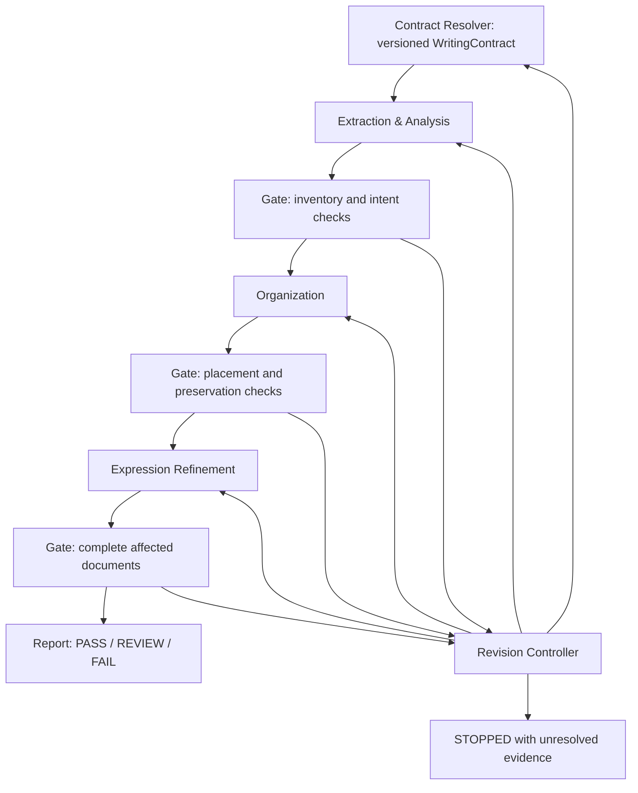

# Common data model and module interfaces

> Implementation-preparation design proposal, based on the [three-module architecture](architecture.md). These are logical contracts, not executable schemas or an adopted fixture format. No pipeline, validator, LLM, retrieval service, or adapter is implemented here. Existing seven-action annotations and fixture schema `0.1.0` remain unchanged. M0 independent human review, holdout assignment, and schema freeze remain incomplete.

## Scope and design choices

The engine carries information independently of paragraphs, files, and expression edits. One paragraph can contain several units with different judgments; one unit can span several passages. A unit is the smallest independently assessable assertion or instruction **with its necessary interpretation context**, not necessarily a sentence. Linked conditions can be separate units, but a claim cannot be delivered without the conditions it needs.

The design uses versioned artifact references and three decision dimensions: preservation, placement, and expression. A single action object would conflate those decisions; embedding a copy of every claim in each module's output would allow them to drift. Instead, modules reference a shared immutable inventory, and each owns its own decisions. Expression plans are embedded in revision results rather than requiring a separate top-level artifact.

Types below are language-neutral notation: `T?` is optional, `T[]` is a list, and tagged alternatives require the fields of their selected branch. Lists may be empty unless a field invariant requires entries; empty findings, assumptions, relations, consolidation groups and destination reviews are valid. Source-unit spans, supported-addition evidence and non-omission trace spans must be nonempty. Required contract information is nonempty when the caller specifies obligations; an empty list does not waive other constraints. IDs are opaque, scoped to a run or a named external snapshot; they are not paths. Enumerations and field names are proposed for this design, not frozen public API choices.

## Shared references and provenance

| Structure | Fields and interpretation |
| --- | --- |
| `ArtifactRef` | `{id, revision, digest}` identifies immutable content. Equality includes all three fields; a newer revision does not silently replace an older dependency. Hash algorithm and canonical serialization remain open. |
| `ArtifactMeta` | `{ref: ArtifactRef, run_id, producer, depends_on: ArtifactRef[]}` on every contract, snapshot, analysis, organization, revision, and validation artifact. Producer identifies component/configuration version; dependencies include policy and check configuration where relevant. |
| `SpanRef` | `{snapshot_ref, start, end}` uses zero-based Unicode code-point offsets, half-open `[start,end)`, against the exact stored text, without newline or Unicode normalization. A quote or line/section hint may be added for display but is not identity. Invalid or mismatched offsets are errors, never silently rebased. |
| `EvidenceRef` | `{id, kind, spans: SpanRef[], source_record?, authority_basis, uncertainty}`. Kinds distinguish user instruction, source assertion, reference evidence, and check observation. Non-text evidence needs an immutable source record instead of a fabricated span. A citation proves provenance, not truth; authority is recorded with its basis. |
| `ScopeRef` | `{contract_ref, scope_id}` resolves a named contract output scope (document, group or response); contract requirements use the same scope IDs. |
| `UnitRef` / `ElementRef` | `{analysis_ref, unit_id}` / `{analysis_ref, unit_id, element_id}`. Inventory-local IDs never resolve against a different analysis revision. |
| `Rationale` | `{reason, evidence_ids: ID[], uncertainty, assumptions: Text[]}`. Uncertainty is qualitative with an explanation; no numeric confidence threshold is fixed. Empty evidence means an explicit unsupported assumption, never verified support. |

Each producing artifact carries an `evidence` collection of `EvidenceRef` records or pins the immutable evidence artifact it uses in `meta.depends_on`; every `evidence_ids` entry must resolve there. Evidence cannot be replaced by an unversioned run-global lookup.

Snapshots of user instructions and reference material use the same snapshot mechanism as documents. A public URL or PR head commit alone does not fix mutable PR body text; store the captured body and capture metadata. Fixture excerpts are partial captures, not reconstructed full documents.

### DocumentSnapshot

| Field | Contract |
| --- | --- |
| `meta`, `document_id`, `version` | Immutable artifact metadata, logical document identity, and source version/capture identity. Output versions are new snapshots of the same document. |
| `content`, `content_digest` | Exact original text and its digest; never overwritten by a revision. |
| `source_record` | Source kind, repository/path or external identifier, Git commit/blob if available, capture time and mutable-source caveat where applicable. A Git blob digest and the engine's content digest are distinct. |
| `coverage` | `complete` or `excerpt`; excerpts record original line ranges and capture boundaries. Offsets always address stored content, not absent original text. |
| `media_type`, `profile` | Media type plus audience/purpose/scope with evidence and uncertainty. A profile is context for routing, not authority to override user intent. |
| `locations` | Optional derived section/block map to `SpanRef`; Markdown headings are one adapter, not the required location system. |

A future dialogue response may be a text snapshot identified by conversation/message rather than a file. Sections become logical groups. The current design does not implement streaming or response interception.

### WritingContract

| Field | Contract |
| --- | --- |
| `meta`, `intent`, `audience`, `purpose`, `document_type` | Explicit desired reader outcome and intended reader/knowledge. Each resolved field records its value, basis (`explicit_user`, `authoritative_context`, or `inferred_assumption`), and evidence IDs. |
| `language`, `register`, `terminology` | Expression constraints, including exclusions for quotations/code/headings as applicable; unspecified style remains explicitly unspecified. |
| `required_information` | Requirement entries `{id, description, evidence_ids, applies_to, protection}`. `applies_to` is a document/group/output scope; `protection` distinguishes exact literal preservation from semantic preservation. Analysis binds these requirements to units/elements or records an unmet requirement. |
| `constraints` | Named rules with scope and verification kind: deterministic, semantic, or human decision. Includes required structure, privacy, claim limits, and disclosure needs. |
| `source_material` | Snapshot/evidence references and their authority basis, including supplied destination context. |
| `intent_resolution` | Conflicts, inferred existing-draft purpose, accepted assumptions, decision evidence, unresolved questions, and predecessor contract reference. Status is `resolved` or `needs_review`. |

The Contract Resolver alone emits a new resolved contract. Analysis may propose a purpose correction with evidence; it cannot overwrite intent. Explicit user intent outranks inferred draft purpose. Conflicting explicit fields or uncertain interpretation produce a finding and `REVIEW`. A missing required field or malformed contract produces `FAIL`. No downstream generation resumes against a changed contract until its dependencies have been rebuilt and checked.

### InformationUnit and InformationAssessment

An `AnalysisResult` contains `{meta, units, assessments, requirement_bindings, coverage_ledger, alignment, findings}`. This is the common output of Information Extraction & Analysis and input to Organization; modules do not invent competing inventories.

| Inventory field | Contract |
| --- | --- |
| `InformationUnit.id`, `origin` | Stable local identity and `source` or `supported_addition`. An addition is a new unit supported by source evidence, not fabricated text. |
| `source_spans`, `evidence_ids` | One or more source locations for source units; supported additions reference authoritative evidence and the missing requirement instead. A synthesized unit must identify every input contribution. |
| `statement` | Normalized assertion/instruction, retaining subject, predicate, object, attribution, quantifier, temporal and scope bounds as applicable. It is an analysis representation, not replacement source text. |
| `elements` | `{id, kind, value, source_spans, evidence_ids, protection}` entries for facts, numbers, units/metrics, conditions, scope/time, attribution, identifiers and citations. Preserve lexical values and measurement context, not just a free-floating number. |
| `relations` | Typed links such as `qualifies`, `supports`, `depends_on`, `duplicates_candidate`, `contradicts_candidate`, with unit/element targets and rationale. Candidate overlap/conflict is not a confirmed equivalence/contradiction. |
| `InformationAssessment.id`, `unit_ref`, `scope_ref` | Explicit assessment identity and scope. Exactly one assessment per `(unit_ref, scope_ref)`. Several scopes can give the same information different relevance and exposure decisions. |
| `relevance`, `importance` | Separate qualitative judgments (`relevant / irrelevant / uncertain`; `required / useful / optional / uncertain`) with individual rationale; not similarity scores. |
| `preservation` | `retain_current`, `preserve_elsewhere_candidate`, `omit_candidate`, `add_supported`, or `undecided`, with rationale. `omit_candidate` requires evidence of no preservation obligation; low relevance alone is insufficient. |
| `exposure` | Per-document requirement to show a claim/condition locally, allow linked detail elsewhere, or keep provenance only. Requires rationale under the [caveat rules](architecture.md#caveat-retention-and-exposure). |
| `protected_elements`, `review_required` | Element references bound to contract requirements or semantic dependencies, plus uncertainty/review reason. Omission candidates with unresolved protection are blocked. |

`requirement_bindings` maps each contract requirement to protected unit/element references or an unmet entry with an `ADD`/`FLAG` proposal. An unsupported gap is **not** an addition unit. `coverage_ledger` accounts for all input blocks as extracted, non-prose/excluded with reason, or unresolved; code and quotations may be excluded from style checks but still carry substantive facts. This catches dropped source passages independently of the module's own list of units.

A paragraph's source spans may overlap: in RW-013, the same paragraph holds an environment-variable instruction, internal OAuth mechanics, and a credential-preservation statement. They have different IDs and assessments. If later splitting/merging units changes their meaning, create a new analysis revision and explicit predecessor links; never reuse stale IDs by assumption.

### OrganizationPlan

`OrganizationPlan = {meta, analysis_ref, placements, consolidation_groups, destination_reviews, affected_documents, findings}`.

| Field | Contract |
| --- | --- |
| `placements` | One resolved disposition per assessed unit/scope: `{id, unit_ref, scope_ref, assessment_id, disposition, targets, rationale}`. `disposition` is `placed`, `omitted`, or `blocked`. `targets` specify logical document, logical section/group and relative order (`before / after / within` with an anchor), or unresolved destination role with **no invented file path**. |
| Target exposure | A target states which unit/elements it exposes, whether it is the primary information home or required local interpretation context, and any link to another target. This allows moving detailed limits while retaining the necessary qualifier beside a source claim. It is not an unrestricted duplicate of the whole unit. |
| `consolidation_groups` | `{id, member_refs, equivalence_basis, retained_elements, member_contributions, targets}`. Every member's conditions, numbers and attribution remain traceable; a union of provenance alone is insufficient. Conflicting scope returns to analysis. Consolidation references original units rather than silently replacing them. |
| `destination_reviews` | Per cross-document destination: immutable snapshot/profile references, inspected ranges, audience/purpose fit, existing-content overlap/conflicts, preconditions, uncertainty and review evidence. Status `verified_context` or `unverified`; the former does not assert runtime truth. |
| `affected_documents` | Full source and destination snapshot dependencies and intended output set. Cross-document removal/integration is one proposed change set; partial publication is not allowed by this contract. |

A `retain_current` unit remains in the current document even if its section/order changes. Organization may select destinations for `preserve_elsewhere_candidate` units, but cannot turn `retain_current` into an authorized cross-document removal or override protection. It requests reassessment when such a change is needed. Any existing destination content participating in overlap/contradiction review or consolidation must first enter the shared analysis inventory with its own source spans and scope-specific assessments. If retrieval discovers it after analysis, the controller requests an expanded AnalysisResult revision and invalidates the dependent plan; Organization cannot mint destination unit IDs.

No source deletion for a move or redundancy is eligible until destination context, consolidated coverage and required local exposure have passed the gate. Unavailable destinations produce `blocked` placements and `REVIEW`; the source stays intact.

Placement anchors must resolve, and the ordering graph must be acyclic. A planned group can be new within an existing document; a missing destination document stays a proposal requiring review. No automatic file creation/publication is implied.

### ExpressionPlan and RevisionResult

`RevisionResult = {meta, organization_ref, expression_plan, output_snapshots, preview_fragments, change_set, trace, findings, delivery_state}`. `delivery_state` is `preview` or `candidate`; neither is gate approval.

| Field | Contract |
| --- | --- |
| `expression_plan` | List of `{id, target, unit_refs, operations, protected_elements, rationale}`. Operations can combine `REVISE` and `COMPRESS`; unchanged rendering is explicit. It consumes resolved placement and does not choose new destinations. |
| `output_snapshots`, `preview_fragments` | For `candidate`, complete proposed text of every affected document with new snapshot identities, no preview fragments. For `preview`, output snapshots may be empty; fragments are separately captured excerpt snapshots with coverage/scope and unresolved plan references. All spans still address exact stored text. A preview cannot masquerade as whole-document delivery. |
| `change_set` | Snapshot-bound edits with before/after spans, expression-plan entry and introducing artifact/module. Untouched text and deletions are also accounted for. No in-place source mutation. |
| `trace` | Many-to-many mappings `{unit_refs, element_refs, output_spans, treatment, justification}`. Treatments include unchanged, rewritten, consolidated, relocated, omitted-with-authorization. Omission has an empty output span list and references its approved assessment/placement; all others need actual output spans. |

Traceability is bidirectional: every retained/protected element resolves to output spans (in all required exposure scopes), and every substantive output assertion resolves to source/addition units and evidence. Multiple input units can form one sentence; a unit can render into several sentences/documents. Citation and condition edges must still reach the claims they support/qualify. A map is a checkable claim, not proof of meaning preservation: deterministic protected-element checks and semantic review examine the actual texts.

Expression cannot delete substantive units, erase locally required conditions, introduce unsupported assertions, or change cross-document destinations. It returns a finding/request to the controller if the plan cannot be expressed safely. Stylistic connective text can lack a factual unit only when explicitly classified as non-substantive and checked for hidden new assertions.

### Seven-action compatibility

`CompatibilityDecision = {scope, primary_action, related_actions, decision_refs, rationale}` is a report projection, not the control state. Scope identifies units/spans, and `decision_refs` points into assessments, placement and expression entries. A complex edit need not collapse to one action; when a legacy consumer requires one label, the reporting policy selects the primary label with a stated rationale and lists the rest. That selection policy remains open; existing fixture labels are copied as provisional annotations, never recomputed or overwritten.

| Label | Projection and limits |
| --- | --- |
| `KEEP` | Retained information in the current document; compatible with internal placement changes and `REVISE`/`COMPRESS`. |
| `MOVE` | Verified cross-document transfer proposal, possibly with local qualifiers left behind; an unresolved destination remains a `MOVE` candidate plus `FLAG`, not an executed move. |
| `REMOVE` | Authorized omission; redundancy requires verified equivalent preservation and exposure elsewhere. No paragraph-wide deletion inferred from one unit. |
| `ADD` | Missing requirement proposal; render only after authoritative evidence supports an addition unit. |
| `REVISE`, `COMPRESS` | Expression operations on preserved units; do not override their protection or placement. |
| `FLAG` | Unresolved purpose, evidence, destination or other ambiguity, with explicit scope and review rationale. |

### ValidationFinding and ValidationReport

| Field | Contract |
| --- | --- |
| `ValidationFinding.id`, `rule_id`, `severity` | Identity, named violated rule, and existing severity vocabulary: `ERROR`, `WARNING`, `INFO`, `UNRESOLVED`. Severity and compatibility action remain separate. |
| `artifact_refs`, `spans`, `unit_refs`, `element_refs` | Exact evaluated artifacts and supporting locations; cross-document spans always carry snapshot identity. Shape/configuration errors can identify fields without fabricated text spans. |
| `evidence_ids`, `rationale`, `uncertainty` | Evidence of violation or uncertainty, including expected vs. observed protected values and scope. |
| `responsible_component`, `origin_ref`, `repair_recommendation` | Earliest known defect introducer (analysis, organization, expression, resolver, or shared infrastructure), artifact revision that introduced it, and proposed repair. Unknown origin is explicit, not guessed from action/severity. |
| `requires_human_review`, `blocking`, `compatibility_decision?` | Review decision and policy-based delivery effect, separate from confidence. The gate assigns blocking disposition using named contract/check rules, not a raw model score. |

`ValidationReport = {meta, checked_artifacts, check_results, findings, gate_state, execution_state, last_gate_state?, stop_reason?}`. Each check result records check ID/version, scope, kind (`deterministic / semantic / human`), evidence and `passed / violated / unresolved / not_run`. Module findings are proposals; only the independently owned gate creates the delivery verdict. Missing required checks cannot count as passed. Infrastructure failures retain outstanding findings even when the report has no text span.

## Module interfaces

All calls consume immutable references and return new artifacts plus findings. A module outcome distinguishes `ready`, `needs_review`, `invalid_input`, and `execution_error`; these are processing outcomes, **not** the gate's four delivery states. Partial artifacts are diagnostic/preview only and cannot feed automatic downstream delivery.

| Interface | Input | Output | Preconditions and responsibility | Failure/recovery |
| --- | --- | --- | --- | --- |
| `analyze` — Information Extraction & Analysis | Resolved WritingContract, source snapshots, user-context/evidence references, optional candidate relation pairs | AnalysisResult, alignment report, optional evidence-backed contract correction request | Contract shape valid; sources addressable. Extract and account for units, link claims/conditions/numbers/attribution/evidence, bind requirements, assess relevance/importance, propose preservation/addition/move candidates. | Invalid spans/contract → `invalid_input` + hard finding. Purpose ambiguity or missing support → `needs_review`. Omitted unit/incorrect assessment → rerun analysis. Accepted purpose correction returns through resolver first. |
| `organize` — Information Organization | Same contract, gate-accepted AnalysisResult, source and candidate destination snapshots/profiles, optional candidate-search response | OrganizationPlan and routing/consolidation findings | Analysis matches contract; all unit/element references resolve. Select destination/section/order, review existing destination content, preserve protected elements and per-document exposure during consolidation. | Missing target context → `needs_review`, no source removal. Scope/claim conflict → analysis request. Cyclic ordering, stale inputs or missing required placements → invalid plan. Retrieval outage may use supplied context; otherwise review, never pretend empty results prove no destination. |
| `refine` — Expression Refinement | Same contract and analysis inventory, gate-accepted OrganizationPlan, protected-element bindings, full affected snapshots | RevisionResult with embedded ExpressionPlan, new snapshots and trace | Only resolved and verified placements may produce a deliverable candidate. Rewrite/compress for register, terminology and clarity without changing preservation/destinations. | Inexpressible protection or plan defect → finding to upstream owner. Number/meaning drift introduced here → expression repair. Missing full documents → preview only. Generation error → `execution_error`; preserve inputs. |

The controller may collect a preview for human review of blocked plans, but marks unresolved portions, keeps original source text, and never passes that preview as a ready plan or completed move. No module writes to Git, a server, or a user's files through these interfaces.

### Search-independent candidate discovery

Organization may call a future `CandidateSearch` port:

- Request: `{contract_ref, analysis_ref, query_unit_refs, task, scope, context_refs, budget_policy_ref}`, where task is destination, related-information, overlap, or potential-conflict discovery. No fixed number of results is prescribed.
- Response: `{request_ref, index_or_corpus_revision, candidates, coverage, limitations}`. Each candidate identifies a document snapshot and optional unit/span, retrieval rationale, method, optional method-specific score/rank, and context-availability status. Results can be empty, partial, stale, unavailable, or complete relative to a declared corpus; not complete relative to all possible knowledge.
- Candidate context must be loaded and verified against the exact snapshot before routing or merging. Scores from different methods need not be comparable. Stale index hits require current context retrieval and rechecking; unavailable context yields `REVIEW`.

Vector embeddings and cosine similarity are an important possible implementation for document-profile affinity and unit overlap. Lexical search, metadata lookup, caller-supplied candidates, or hybrid retrieval can satisfy the same port. Similarity is neither relevance/importance nor truth, equivalence, deletion authority, or intra-document ordering. Potential contradictions return to analysis; destination decisions remain Organization's responsibility. No embedding model, vector database, provider, or threshold is chosen.

## Gate, dependencies, and recovery

| Boundary / invariant | Gate evidence and defect routing |
| --- | --- |
| Contract → analysis | Required fields, intent provenance, complete requirement bindings, input-block coverage, snapshot/span/digest validity. Purpose mismatch goes to analysis/resolver; extraction gaps to analysis. |
| Analysis → organization | Each unit has a scoped assessment and every protected element is reachable; claims retain conditions, metrics and attribution. Unsupported addition or incorrect preservation returns to analysis. |
| Organization → expression | Every unit has a resolved disposition, every destination is inspected, every consolidation member contributes its required elements, ordering is acyclic, source-visible claims keep necessary local conditions. Routing or merge loss returns to organization. |
| Expression → final report | Actual output text and both-direction trace satisfy all required facts, numbers, conditions, citations and attribution. Full source and destination documents, including untouched passages, are checked for contradictions, register and exposure. Wording drift returns to expression; pre-existing factual ambiguity to analysis. |
| All boundaries | Artifact dependencies match exactly, input text is untrusted data, checks actually ran, and no unresolved required decision is hidden. A module's `ready` or self-evaluation is never a gate verdict. |

The gate checks extraction coverage against source text independently; otherwise an absent unit could escape every later preservation check. Likewise it checks output assertions independently of the submitted trace. Deterministic rules can compare protected literals and references; semantic scope, attribution and caveat proximity need contextual review. A human may decide an unresolved issue with recorded evidence; a model declaration alone does not settle it. A `PASS` is bounded to configured checks and checked snapshots, not proof of factual completeness.

### Invalidation and defect ownership

Dependency edges are recorded in `meta.depends_on`. A changed contract invalidates dependent assessments, organization, expression and validation. Changed extraction/assessment invalidates organization and expression; changed organization invalidates expression. Any changed output invalidates its prior gate report. A source/destination update also invalidates its spans, extracted inventory, context reviews and all dependent results. The controller must reject stale artifacts even if their IDs or apparent text match.

Selective reuse is permitted only for artifacts whose complete dependency references are unchanged and whose independence is recorded; conservative full downstream recomputation is valid. Each accepted edit ends in whole-document validation across the complete affected change set. No full-document `PASS` is possible from fixture excerpts alone.

The controller compares the last gate-accepted boundary with the first artifact that loses an element or changes a claim. If the unit was absent during extraction, analysis owns the defect; if a complete analysis was misrouted/consolidated, organization owns it; if a correct plan was rewritten incorrectly, expression owns it. Unclear causes return to analysis with available evidence, as in PR #3. Resolver failures route to the resolver; validator/execution faults go to infrastructure rather than asking a writer to compensate.

Every attempt records input/output refs, findings introduced/resolved, owner, repair request and invalidations. Reverting a regressive candidate retains the last accepted artifacts and marks the rejected attempt; it does not publish a partial move or erase the audit trail. Unsupported repairs stay reviewable instead of inventing facts.

### Bounded outcomes

The controller requires a finite `attempt_policy` (including a total run-wide limit and no-progress/repetition detection); the actual limit and comparison algorithm remain open. Module switches or contract repairs do not reset the total budget. The architecture's earlier default of three is only a prior proposal, not an adopted numerical setting.

| State | Meaning and handling |
| --- | --- |
| `PASS` | All configured required checks ran and passed, with no blocking findings/review decisions across full affected documents. Optional INFO can remain. Deliver a candidate/report, not automatic publication. |
| `REVIEW` | No confirmed hard failure, but required semantic/human decisions, unverified destinations or intent conflicts remain. Stop automatic editing and return original/preview, evidence and specific open questions. |
| `FAIL` | Confirmed hard requirement violation. If cause/evidence permit bounded repair, route to owner and recheck; otherwise return failure. An unresolved issue does not hide a simultaneous confirmed failure. |
| `STOPPED` | Attempt limit, repeated/non-improving state, cancellation or execution error prevented completion. Include stop reason, latest attempted candidate, last accepted artifacts, outstanding findings and last actual gate state, if any. |

Gate delivery precedence is confirmed hard failure → `FAIL`; otherwise blocking unresolved decision → `REVIEW`; otherwise all required checks passed → `PASS`. A not-run required check prevents `PASS`: unavailable semantic evidence yields `REVIEW`; execution breakdown that prevents checking yields `STOPPED`. `STOPPED` is a controller terminal outcome and preserves `last_gate_state` rather than implying the last violation vanished. ValidationReport carries `execution_state` to keep execution completion separate from content correctness.

## Manual walkthroughs using provisional candidates

These are design walkthroughs of the **stored excerpts and annotations** in [real-world-candidates.json](../tests/fixtures/real-world-candidates.json). They are not executable evaluations, remote-source rechecks, full-document edits, human review or label adoption. IDs below are local illustrative aliases. Line locations refer to fixture captures; a future adapter computes exact `SpanRef` offsets in each captured text. Plans and result text are previews; missing full documents/context block a final `PASS`. Findings below distinguish observed missing context from hypothetical injected defects.

### RW-008 — recover a misidentified purpose before restructuring

| Step | Data flow |
| --- | --- |
| Input | Captured `resume.md` lines 67–68, commit `a01e81e…`, plus the fixture contract for quickly scanning recruiters. Existing action remains provisional `FLAG`; exact structure remains unresolved. |
| InformationUnit | `8a`: comparison and selection on the same 20-sentence GPU benchmark, including all four `0.1985s / 0.2041s / 6.9075s / 28.1953s` values; `8b`: resulting generation-time change `5.6ms(+2.8%)`; `8c`: later `G_2800` benchmark `mean 0.38s / p95 0.53s / RTF 0.0894`; `8d`: real STT+NLU with **MockTTS**, 50-turn isolated E2E, `p95 312.2ms`. Remaining integration/training/closure facts are separately accounted for, not discarded as connective text. |
| Assessment | Preserve actual contribution, judgment and scoped results. The inherited action/result template or an inferred activity-log purpose must not force extra compression. Alignment proposes a purpose correction only if the supplied contract was wrongly inferred; the fixture's actual purpose is already the target and is not rewritten. |
| OrganizationPlan | Block final restructuring pending whole-resume and template review. Candidate same-document groups can separate contribution, selection evidence and validation scope; record `placement`, not `MOVE`. No final group choice or `REVISE` scope is claimed. |
| RevisionResult | `delivery_state: preview`; retain captured text as-is, trace `8a…8d` to their unchanged spans. A later approved structure may combine sentences, but cannot conflate the same-20-sentence comparison, production-checkpoint benchmark and MockTTS test. No compressed replacement is asserted here. |
| ValidationFinding | Observed limitation: `PURPOSE_STRUCTURE_REVIEW`, `UNRESOLVED`, analysis/resolver, human review required. Gate `REVIEW`. Injected defect example: calling `312.2ms` production TTS latency would be scope loss; route to whichever artifact first introduced that claim. |

This explicitly supports a meaningful partial result when safe final structure cannot yet be chosen. It preserves the candidate's open questions rather than deciding that more compression solves the issue.

### RW-013 — distinct decisions inside the same paragraph

| Step | Data flow |
| --- | --- |
| Input | Captured QuotaTray README lines 54–62, commit `e62eb5c…`; purpose: users understand refresh after login. Provisional primary action stays `MOVE`, restricted to internals/developer diagnosis. |
| InformationUnit | `13a`: after successful Antigravity/agy login creates a local OAuth session, refresh can work with agy off; `13b`: ordinary users need no OAuth environment variables; `13c`: metadata lookup, **SHA-256** fingerprint validation and dedicated cache storage; `13d`: do not overwrite `gemini:antigravity`; `13e`: exact TestCli command with its source/development-environment context. `13b`, `13c`, `13d` occupy one paragraph but are separate units. |
| Assessment | `13a/b/d`: `retain_current`, with conditions/identifier protected; `13c/e`: `preserve_elsewhere_candidate`. The user-facing credential impact stays visible; detailed ownership can also appear with the design explanation. This reuses the fixture's scoped `information_decisions`, without revising its primary label. |
| OrganizationPlan | Place `13a/b/d` under current authentication/first-use guidance. `13c` targets an authentication-design **role**, `13e` a developer-troubleshooting **role**; actual paths/context remain unverified. Both transfers are blocked. Any overlap search must inspect destination conditions and existing ownership statements first. |
| RevisionResult | Local preview sentence: “Antigravity/agy에서 한 번 정상 로그인해 로컬 OAuth 세션이 생성되면, 이후 agy가 꺼져 있어도 쿼터를 갱신할 수 있습니다. 일반 사용자는 OAuth 환경변수를 따로 설정할 필요가 없으며, 기존 `gemini:antigravity` 자격증명을 덮어쓰지 않습니다.” It maps to `13a/b/d` and allows `KEEP` + `REVISE`. Until destinations are verified, retain `13c/e` unchanged in the source; no completed move/change set exists. |
| ValidationFinding | Observed limitation: `DESTINATION_UNVERIFIED`, `UNRESOLVED`, organization, review required → `REVIEW`. Injected deletion of `13d` during polishing yields `PROTECTED_INFORMATION_LOST`; with an intact plan, expression owns the repair. |

A whole-paragraph `MOVE` would incorrectly remove user guidance. The separate unit assessments and multiple expression operations avoid that failure.

### RW-012 — move detailed limits and preserve interpretation conditions

| Step | Data flow |
| --- | --- |
| Input | Captured `resume.md` lines 79–84, commit `a01e81e…`; audience: recruiters/technical interviewers. Provisional `MOVE` applies to detailed limits, not all contributions. Final destination path is unknown. |
| InformationUnit | `12a`: LLM screening/evaluation (`40`, `22 × 30 = 660`, final `4`) and local default **candidate**, with synthetic-evaluation scope; `12b`: defect discovery/review contribution versus teammate verifier patch; `12c`: C2 `1,233`-item evaluation WER `9.77%`, versus existing `119`-item retention WER `15.33% → 16.81%`; `12d`: CI changes and limited verification, not full deployed E2E/cost benefit. Detailed caveats link to their respective claims. |
| Assessment | Retain contributions and necessary scope/attribution. Detailed validation limits are move candidates. For `12c`, dataset, metric, regression and no operational-replacement-success implication are protected together; a positive-only rewrite is not permitted. Other numeric details remain in the inventory and need verified destination coverage if omitted locally. |
| OrganizationPlan | Current resume exposes concise scoped claims; a project-evidence destination exposes detailed measurements/limits near the relevant evidence. Target role is provisional, not a fabricated filename. Consolidation requires per-element contribution mapping and checks both current and destination claims. |
| RevisionResult | Illustrative current-document preview for `12c`: “Whisper Medium QLoRA 학습·데이터 정제와 평가를 수행했습니다. 후보 C2는 1,233건 평가 WER 9.77%였으나, 기존 119건 retention WER는 15.33%에서 16.81%로 악화했습니다.” This maps all these elements to visible spans and does not claim general improvement/model replacement. Detailed limits stay at source until a real destination is inspected and integrated. Other contributions remain unchanged in this preview. |
| ValidationFinding | Observed limitation: `DESTINATION_UNVERIFIED` → organization, `REVIEW`. Injected defect: a rewrite saying “전반적 성능 개선” or replacing necessary local qualifiers with a bare link triggers `CLAIM_SCOPE_BROADENED` / `CAVEAT_EXPOSURE_LOST`. Owner is organization if exposure was omitted in the plan; expression if a correct exposure plan was ignored. |

Moving detail is not deleting limitations from the information corpus, and corpus preservation alone does not establish adequate local exposure. No target-preservation claim is made without its text.

### RW-005 — KEEP permits placement and expression changes

| Step | Data flow |
| --- | --- |
| Input | Captured release notes lines 7–10, commit `dcc9ed7…`; readers are update users and maintainers. Provisional action remains `KEEP`. |
| InformationUnit | `5a`: public endpoint readiness and early runtime/tunnel exit; `5b`: restored Git mode `100755` for `install.sh` after fresh clone; `5c`: permission preservation on patches/overwrites/moves/rollback; `5d`: executable mode restoration for `scripts/e2e-release-bootstrap.sh`, tests and CI checks for **both** bootstrap scripts. |
| Assessment | All retain information in the current release notes. Literal script names/mode and behavior conditions are protected. These are captured release assertions, not newly verified test/runtime facts. |
| OrganizationPlan | User changes `5a/b/c` first; place `5d` after them or in a verification group of the **same document**. The proposed group need not already be a heading. A new document is neither required nor authorized. |
| RevisionResult | Expression preview for `5b`: “Restores `install.sh` Git mode (`100755`) so `./install.sh` works after a fresh clone.” Trace joins this sentence to `5b` and its mode/script/fresh-clone elements. `5a/c/d` retain their full text while `5d` may change position. `KEEP` is compatible with `COMPRESS`/`REVISE` and placement. |
| ValidationFinding | No violation is demonstrated in that local sentence; record check observations rather than inventing an ERROR. Missing complete-document context leaves the delivery gate at `REVIEW`. Injected omission of `100755` fails the protected-literal check and routes to expression, not organization merely because ordering also changed. |

### Walkthrough conclusions and limits

Within each walkthrough, all stages reference that case’s same contract, snapshot and unit identities through assessment, placement, expression trace and findings. They exercise partial results, multi-unit paragraphs, separate decisions, local exposure after a move, scope/number/attribution protection, and defect-origin routing. Their present outcome is reviewable design evidence, not successful end-to-end validation. None establishes a verified destination, complete-document correctness, runtime behavior, final label or a benchmark score.

## Decided for this proposal and still open

| Decided design boundary | Remaining decision before implementation/adoption |
| --- | --- |
| Immutable versioned dependencies, snapshot-bound Unicode code-point spans, many-to-many unit/element trace | Hash algorithm, canonical serialization, ID generation and adapter conversion from bytes/UTF-16; executable schema/version negotiation |
| Units independent of paragraphs; conditions and evidence have typed links; preservation/placement/expression separate | Language-specific segmentation, cross-paragraph relation extraction, human annotation guidance and interoperability with fixture fields |
| One inventory, scoped assessments, explicit destination review and element contributions for consolidation | Precision of equivalence/contradiction evidence, minimum inspected context, destination profile encoding and retrieval evaluation |
| Resolver-only contract repair, independent gate verdicts, earliest-defect routing, downstream invalidation | Human decision UX, semantic-review rubric, optional-warning blocking policy, selective-reuse proof and no-progress algorithm |
| Finite run-wide revision budget and distinct content/execution status | Actual retry limits, timeout/cancellation configuration and operational error taxonomy |
| Seven legacy actions retained as a scoped reporting projection | Primary-label tie breaking, fixture mapping and any future migration after human review; no automatic relabeling |
| Medium-neutral snapshot/group model | Future dialogue/streaming adapters; no conversational delivery or interception implementation |

Implementation language, LLM/provider, embedding model, vector database and numeric thresholds remain open. Requirements, evaluation policy and milestones retain their existing ownership; this document specifies the data exchanged across the architecture, not new M0 completion claims.
