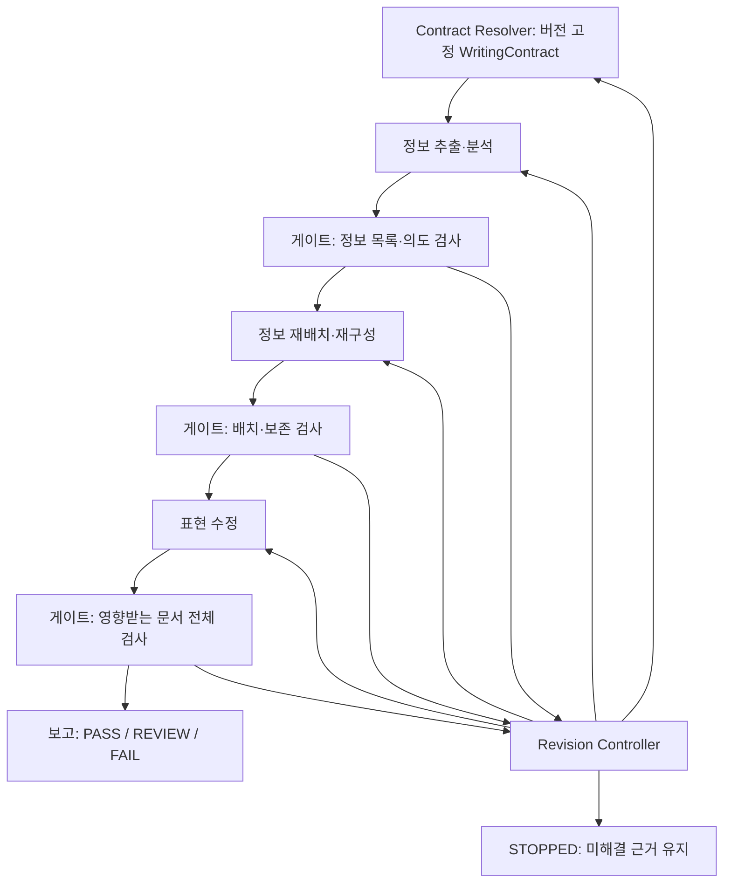

# 공통 데이터 모델과 모듈 인터페이스

> **구현 준비 단계의 논리 설계 제안.** [세 모듈 아키텍처](architecture.md)에 기반하지만 실행 가능한 스키마나 채택된 평가 데이터 형식은 아니다. 파이프라인·검증기·LLM·검색 서비스·어댑터는 아직 구현되지 않았다. 기존 7개 액션과 평가 스키마 `0.1.0`은 변경하지 않는다. M0 독립 사람 검토·홀드아웃 분리·스키마 동결도 미완료다.

## 범위와 설계 선택

엔진에서 정보는 문단·파일·표현 변경과 독립적으로 존재한다. 한 문단에 서로 다른 판단이 필요한 정보가 여럿 있을 수 있고, 한 정보 단위가 여러 위치에 걸칠 수도 있다. **정보 단위**는 해석에 필요한 조건을 포함해 독립적으로 평가할 수 있는 가장 작은 주장·지시이며, 반드시 한 문장은 아니다. 조건을 별도 단위로 추출할 수는 있지만 그 조건이 필요한 주장을 조건 없이 전달해서는 안 된다.

설계는 **버전이 고정된 산출물 참조**와 보존·배치·표현이라는 세 판단을 사용한다. 이를 하나의 액션에 묶으면 판단이 섞이고, 각 모듈이 주장을 복제하면 내용이 서로 달라질 수 있다. 따라서 모듈은 하나의 변경 불가능한 정보 목록을 참조하고 각자 자신의 판단만 소유한다. 표현 계획은 별도 최상위 산출물 대신 수정 결과에 포함한다.

아래 표기는 구현 언어와 무관하다. `T?`는 선택 필드, `T[]`는 목록이며 태그가 있는 대안은 해당 가지의 필수 필드를 따른다. 별도 불변조건이 없으면 목록은 비어 있을 수 있다(예: 발견 사항·가정·관계·통합 그룹·목적지 검토). 다만 원본 정보의 원문 범위, 근거가 있는 추가 정보의 증거, 생략이 아닌 추적 항목의 출력 범위는 비어서는 안 된다. 호출자가 필수 정보를 지정했으면 해당 요구사항이 충족돼야 하고, 빈 목록으로 다른 제약을 면제할 수 없다. ID는 실행 또는 고정된 외부 스냅샷 범위의 불투명 식별자이며 파일 경로가 아니다. 필드·열거값은 **제안**이며 공개 API로 확정되지 않았다.

## 공통 참조와 출처

| 구조 | 필드와 의미 |
| --- | --- |
| `ArtifactRef` | `{id, revision, digest}`: 변경 불가능한 콘텐츠 식별자. 세 필드 모두 같아야 동일하며 최신 버전이 기존 의존성을 암묵적으로 대체하지 않는다. 해시 알고리즘·정규 직렬화 방식은 미정. |
| `ArtifactMeta` | `{ref: ArtifactRef, run_id, producer, depends_on: ArtifactRef[]}`: 계약·스냅샷·분석·재배치·수정·ValidationPlan·ValidationReport에 포함. `producer`는 구성 요소/설정 버전, 의존성은 검증 정책과 설정도 포함. |
| `SpanRef` | `{snapshot_ref, start, end}`: 정확히 저장된 텍스트의 0부터 시작하는 유니코드 코드 포인트 오프셋, 반개구간 `[start,end)`. 줄바꿈·유니코드 정규화는 하지 않는다. 인용·행/섹션 힌트는 표시용일 뿐 식별 기준이 아니다. 불일치·범위 오류를 임의로 보정하지 않는다. |
| `EvidenceRef` | `{id, kind, spans: SpanRef[], source_record?, authority_basis, uncertainty}`: 사용자 지시·원문 주장·참고 근거·검사 관측을 구별한다. 비텍스트 근거는 가짜 텍스트 범위가 아니라 변경 불가능한 외부 기록을 사용한다. 인용은 **출처**를 증명할 뿐 **진실**을 증명하지 않는다. |
| `ScopeRef` | `{contract_ref: ArtifactRef, scope_id}`: 정확히 그 계약의 `output_scopes` 항목 하나에 연결한다. 최신 계약이나 선언되지 않은 역할·경로에 자동 연결하지 않는다. 계약 내부에서는 자기 해시 순환 참조를 피하려고 `scope_id`만 쓴다. |
| `UnitRef` / `ElementRef` | `{analysis_ref, unit_id}` / `{analysis_ref, unit_id, element_id}`. 정보 목록 안의 ID는 다른 분석 버전에 자동 적용되지 않는다. |
| `Rationale` | `{reason, evidence_ids: ID[], uncertainty, assumptions: Text[]}`. 불확실성은 설명과 함께 정성적으로 기록한다. 숫자 확신도 임계값을 정하지 않는다. 증거가 비었다면 검증된 사실이 아니라 명시적 가정이다. |

산출물은 `EvidenceRef` 모음을 갖거나 `meta.depends_on`에서 변경 불가능한 증거 산출물을 고정한다. 모든 `evidence_ids`는 해당 고정된 자료에서 해석돼야 하며 버전 없는 전역 조회에 의존할 수 없다.

사용자 지시·참고 자료도 문서처럼 스냅샷으로 저장한다. 공개 URL이나 PR 헤드 커밋은 변경 가능한 PR 본문을 고정하지 못하므로 실제 조회 본문과 시점도 보존한다. 평가 자료의 발췌는 **부분 스냅샷**이지 원문 전체가 아니다.

### DocumentSnapshot

| 필드 | 계약 |
| --- | --- |
| `meta`, `document_id`, `version` | 변경 불가능한 메타데이터, 논리 문서 ID, 원본 버전·수집 ID. 수정본은 동일 논리 문서의 새로운 스냅샷이다. |
| `content`, `content_digest` | 정확한 원본 텍스트와 다이제스트. 기존 스냅샷을 덮어쓰지 않는다. |
| `source_record` | 출처 유형·저장소/경로·외부 ID·Git 커밋/Blob·수집 시점·변경 가능한 출처의 주의사항. Git Blob과 엔진 자체 콘텐츠 다이제스트는 다르다. |
| `coverage` | `complete` 또는 `excerpt`; 발췌는 원문 행 범위·수집 경계를 기록한다. 오프셋은 저장된 발췌 기준이다. |
| `media_type`, `profile` | 매체 유형과 독자·목적·범위의 근거 및 불확실성. 라우팅 참고 정보이지 사용자 의도보다 우선하지 않는다. |
| `locations` | 선택적인 섹션·블록 → `SpanRef` 지도. Markdown 제목은 가능한 어댑터 중 하나다. |

향후 대화 응답은 파일 대신 대화·메시지 식별자로 스냅샷을 만들고, 섹션 대신 논리적 그룹을 사용할 수 있다. 지금은 스트리밍이나 응답 가로채기를 구현하지 않는다.

### WritingContract

| 필드 | 계약 |
| --- | --- |
| `meta`, `intent`, `audience`, `purpose`, `document_type` | 원하는 독자 결과·대상 독자와 지식 수준. 각 해석 필드는 값, 근거 유형(`explicit_user`·`authoritative_context`·`inferred_assumption`), 증거 ID를 갖는다. |
| `language`, `register`, `terminology` | 인용·코드·제목의 제외 조건을 포함할 수 있는 표현 제약. 미지정 문체는 미지정으로 남긴다. |
| `output_scopes` | 아래에서 정의하는 **비어 있지 않은 출력 범위 선언 목록**. `ScopeRef.scope_id`의 유일한 선언 장소다. |
| `required_information` | `{id, description, evidence_ids, applies_to, protection}`. `applies_to`는 `{scope_id, coverage}`의 비어 있지 않은 목록이며, `protection`은 문구 그대로 보존할지 의미를 보존할지 구별한다. 분석은 범위별 의무를 정보·요소와 연결하거나 누락으로 기록한다. |
| `constraints` | 검증 유형(결정론·의미·사람 결정), 출력 범위, 필수 구조·개인정보·주장·공개 요구를 담은 규칙. |
| `source_material` | 제공된 목적지 맥락을 포함한 스냅샷·증거 참조 및 권위의 근거. |
| `intent_resolution` | 충돌·초안에서 추론한 목적·채택 가정·결정 근거·미해결 질문·이전 계약 참조. `resolved` 또는 `needs_review`. |

새로운 해석 계약을 만드는 권한은 **Contract Resolver**에만 있다. 분석 모듈은 근거가 있는 목적 수정안을 제안할 뿐 의도를 덮어쓰지 않는다. 명시적 사용자 의도는 초안에서 추론한 목적보다 우선한다. 명시 필드끼리 충돌하거나 해석이 불확실하면 `REVIEW`를 기록한다. 필수 필드 누락·잘못된 계약은 `FAIL`이다. 계약 변경 시 의존성을 다시 구축·검사하기 전에는 다음 단계의 생성을 재개하지 않는다.

### 출력 범위 선언과 참조 무결성

각 `output_scopes` 항목은 `{scope_id, kind, target, audience?, purpose?}`다. ID는 계약 내부에서 유일해야 한다. 독자·목적의 선택적 재정의에도 근거 기록이 필요하며, 생략하면 계약 값을 상속한다. 사용자 의도 우선 원칙은 그대로 유지한다.

| `kind` | `target`과 해석 |
| --- | --- |
| `document` | 실제 논리 문서의 `{document_id}`, 또는 경로를 만들지 않은 잠정 목적지 역할 `{destination_role}`. 역할은 실존 문서가 아니므로 문서·검사된 스냅샷을 연결하려면 새 계약 버전이 필요하다. |
| `document_group` | `{member_scope_ids}`: 같은 계약의 문서 범위들을 중복 없이 나열한 비어 있지 않은 목록. 그룹 중첩 불가. 디렉터리·변경 가능한 검색 결과로 소속을 추론하지 않는다. |
| `response` | 예정된 대화 출력의 `{response_id}`. 향후 대화/메시지 식별자와 연결할 수 있지만 현재 구현되지 않은 논리 범위다. |

`coverage: each_member`는 그룹 구성원 **각각**에서 정보를 보존해야 한다는 뜻이다(단일 문서·응답이면 그 하나). `coverage: across_group`은 문서 그룹 전체에 걸쳐 보존하는 조건에서만 허용한다. 모든 구성원에 반복할 필요는 없지만, 현재 문서에 나타난 주장을 이해하는 데 필요한 조건을 생략해도 된다는 뜻은 아니다. 범위가 겹치는 의무는 누적되며 그룹 전체 의무가 개별 문서 의무를 없애지 않는다. 범위를 지정한 제약도 같은 ID·범위 규칙을 사용한다.

해석기는 선언과 내부 참조를 먼저 검사한다. 이후 게이트는 외부 `ScopeRef.contract_ref`가 산출물에 고정된 계약과 일치하는지, ID가 정확히 한 번 선언됐는지, 범위 종류·적용 범위가 작업을 허용하는지 검사한다. 미존재·중복 ID/구성원, 잘못된 그룹 소속·범위 조건·계약 버전, 선언 밖 배치는 `invalid_input` + `ERROR` + `FAIL`이다. 기본 범위로 대체하지 않는다. **선언됐지만 실제 문서로 연결되지 않은 목적지 역할**은 참조 오류가 아니라 `REVIEW`로 이동을 차단한다. 그룹/역할이 전체 문서 검사에서 빠진 출력을 감출 수는 없다.

`InformationAssessment`의 `ScopeRef`는 **그 출력 범위에 한정된** 관련성·중요도·보존·노출 판단이다. 문서별 `retain_current`는 해당 문서의 정보를 보호하며, 그 문서에서의 생략이 다른 문서나 원본 지식의 삭제를 허용하지 않는다. 그룹 평가는 집계 판단이므로 개별 문서 평가보다 우선하지 않는다. 전달 전 각 정보·최종 출력 쌍과 요구사항 연결에 필요한 평가를 확보해야 한다. 잠정 역할의 평가는 가능해도 확정 배치는 불가능하다.

`requirement_bindings`는 `{requirement_id, scope_ref, coverage, unit_refs, element_refs, unmet_reason?}`를 기록하고 그룹 의무는 구성원으로 확장한다. 배치 계획은 정확한 평가 ID·정보·범위를 참조하며 목적지는 그 범위의 문서 또는 구성원이어야 한다. 문서 간 이동은 원본 처리와 목적지 배치를 각각의 범위·평가로 연결한다. 선택적 `transfer_peer_ids`는 같은 계획의 상대 배치 ID를 가리키며 같은 정보여야 한다. 원본 처리 결과에 외부 문서를 끼워 넣지 않고, 원본에 남아야 할 조건은 별도 배치 대상으로 기록한다. 재배치 모듈은 새 범위를 만들거나 의무를 버려 충돌을 해결하지 않는다. 필요하면 분석·해석기로 돌아가고 종속 산출물을 무효화한다.

### InformationUnit과 InformationAssessment

`AnalysisResult = {meta, units, assessments, requirement_bindings, coverage_ledger, alignment, findings}`는 추출·분석의 공통 결과이자 재배치의 입력이다. 모듈마다 서로 다른 정보 목록을 만들지 않는다.

| 정보 목록 필드 | 계약 |
| --- | --- |
| `InformationUnit.id`, `origin` | 목록 안에서 안정적인 ID와 `source` 또는 `supported_addition`. 추가 정보는 원자료에 근거해야 한다. |
| `source_spans`, `evidence_ids` | 원문 정보에는 하나 이상의 위치. 추가 정보에는 권위 있는 증거·누락 요구사항. 여러 정보를 종합했다면 모든 원본 기여를 표시한다. |
| `statement` | 주체·관계·대상·귀속·수량 한정·시간·범위를 포함하는 정규화된 주장/지시. **원문 대체 문장**이 아니라 분석 표현이다. |
| `elements` | `{id, kind, value, source_spans, evidence_ids, protection}`: 사실·수치·측정 단위·조건·범위/시간·귀속·식별자·인용. 수치뿐 아니라 측정 맥락과 원문 값도 유지한다. |
| `relations` | `qualifies`·`supports`·`depends_on`·`duplicates_candidate`·`contradicts_candidate` 등 다른 단위/요소에 대한 유형 있는 관계와 근거. 중복·모순 **후보**는 확정 판단이 아니다. |
| `InformationAssessment.id`, `unit_ref`, `scope_ref` | 평가 ID와 정보·출력 범위 참조. 정확히 한 `(unit_ref, scope_ref)` 쌍에 하나의 평가를 둔다. 같은 정보에 여러 출력 범위의 서로 다른 평가가 가능하다. |
| `relevance`, `importance` | 관련성(`relevant`/`irrelevant`/`uncertain`)과 중요도(`required`/`useful`/`optional`/`uncertain`)를 각각 근거와 함께 기록한다. 유사도 점수가 아니다. |
| `preservation` | `retain_current`·`preserve_elsewhere_candidate`·`omit_candidate`·`add_supported`·`undecided`와 근거. `omit_candidate`에는 별도 보존 의무가 없다는 증거가 필요하다. 낮은 관련성만으로 부족하다. |
| `exposure` | 주장을 현재 문서에 직접 노출해야 하는지, 세부사항 링크로 충분한지, 출처 기록만 남기면 되는지와 [조건 노출 원칙](architecture.md#주의사항-보존과-노출)에 따른 이유. |
| `protected_elements`, `review_required` | 계약 또는 의미상 의존성과 연결된 보호 요소 및 사람 검토 필요 사유. 보호 여부가 불확실한 생략 후보는 차단한다. |

`requirement_bindings`는 확장된 요구사항·범위 의무를 보호 정보·요소에 연결하거나 근거가 부족한 `ADD`/`FLAG`로 표시한다. **근거 없는 누락은 실제 추가 정보 단위가 아니다.** `coverage_ledger`는 모든 입력 블록을 추출됨·비산문/검사 제외(이유 명시)·미해결로 분류한다. 코드·인용이 문체 검사에서 제외돼도 중요한 사실을 담을 수 있다. 게이트는 이 기록으로 정보 목록 자체에서 빠진 부분을 별도로 확인한다.

정보 단위의 원문 범위는 겹칠 수 있다. RW-013의 한 문단에는 환경변수 안내, 내부 OAuth 방식, 자격증명 보존 지시가 함께 있으므로 ID·판정이 다르다. 분할·통합으로 뜻이 달라지면 이전 단위 연결을 남긴 새 분석 버전을 만들고 오래된 ID를 재사용하지 않는다.

### OrganizationPlan

`OrganizationPlan = {meta, analysis_ref, placements, consolidation_groups, destination_reviews, affected_documents, findings}`

| 필드 | 계약 |
| --- | --- |
| `placements` | 평가된 정보·범위 쌍마다 하나의 처리 기록 `{id, unit_ref, scope_ref, assessment_id, disposition, targets, transfer_peer_ids?, rationale}`. `disposition`은 `placed`·`omitted`·`blocked`. 목적지에는 논리 문서·섹션/그룹·기준점에 대한 상대 위치(`before`/`after`/`within`) 또는 **가짜 경로가 없는 미확정 역할**을 기록한다. |
| 대상의 노출 정도 | 어떤 정보·요소를 보여주는지, 정보의 주 저장처인지 원본 주장을 해석하기 위한 필수 조건인지, 다른 대상과의 링크가 있는지 표시한다. 전체 단위를 무제한 복제한다는 뜻은 아니다. |
| `consolidation_groups` | `{id, member_refs, equivalence_basis, retained_elements, member_contributions, targets}`. 통합 전 각 구성원의 조건·수치·귀속·기여를 추적한다. 출처 목록을 합쳤다는 것만으로 충분하지 않다. 적용 범위가 충돌하면 분석으로 돌아간다. |
| `destination_reviews` | 목적지마다 고정된 스냅샷·프로필·검토한 범위·독자/목적 적합성·중복/충돌·선행조건·불확실성·검토 증거를 기록한다. `verified_context`/`unverified`는 문맥 확인 여부이지 실제 동작의 진실을 보증하지 않는다. |
| `affected_documents` | 전체 원본·목적지의 스냅샷 의존성과 변경할 출력의 집합. 문서 간 제거·통합은 하나의 변경 묶음이며 부분 출판은 허용하지 않는다. |

문서별 `retain_current` 정보는 섹션·순서가 바뀌더라도 해당 문서에 남는다. 재배치는 `preserve_elsewhere_candidate`의 목적지를 고를 수 있지만 `retain_current`를 독단적으로 문서 간 삭제로 바꿀 수 없다. 목적지 기존 내용을 중복·모순 판단이나 통합에 사용하려면 **그 내용도 먼저 공통 분석 목록에 편입**해야 한다. 검색 후 새로 발견했다면 제어기가 확장 분석을 요청하고 기존 배치 계획을 무효화한다. 재배치 모듈은 자체적으로 목적지 정보 ID를 만들지 않는다.

문서 간 이동·중복 제거로 원본을 삭제하기 전에 목적지 문맥·통합 후 보존·원본에 필요한 조건 노출이 게이트를 통과해야 한다. 목적지가 없으면 `blocked`/`REVIEW`로 남기고 원본을 지운 것으로 처리하지 않는다. 배치 기준점은 해석 가능해야 하고 순서 그래프에 순환이 없어야 한다. 기존 문서에 새 그룹을 만드는 것은 가능하지만, 없는 대상 문서의 자동 생성·출판을 뜻하지 않는다.

### ExpressionPlan과 RevisionResult

`RevisionResult = {meta, organization_ref, expression_plan, output_snapshots, preview_fragments, change_set, trace, findings, delivery_state}`. `delivery_state`는 `preview` 또는 `candidate`이며 **둘 다 게이트 승인 자체는 아니다.**

| 필드 | 계약 |
| --- | --- |
| `expression_plan` | `{id, target, unit_refs, operations, protected_elements, rationale}` 목록. `REVISE`와 `COMPRESS`를 같이 적용할 수 있으며 수정 없는 표현도 명시한다. 확정 배치를 입력으로 받되 새 목적지를 정하지 않는다. |
| `output_snapshots`, `preview_fragments` | `candidate`는 모든 관련 문서의 **완전한 새 스냅샷**을 담고 미리보기 조각이 없어야 한다. `preview`는 출력 문서가 비어 있을 수 있으며 조각은 범위·문맥·미해결 계획을 갖는 별도 발췌 스냅샷으로 저장한다. 모든 오프셋은 정확한 저장 텍스트에 연결한다. 미리보기를 전체 문서 결과처럼 전달하지 않는다. |
| `change_set` | 스냅샷에 고정된 전후 위치, 표현 계획, 변경을 일으킨 모듈/산출물. 유지한 부분·삭제도 모두 설명한다. 원본을 제자리에서 수정하지 않는다. |
| `trace` | `{unit_refs, element_refs, output_spans, treatment, justification}`의 다대다 대응. 그대로 유지·재작성·통합·이동·승인된 생략을 구별한다. 생략은 출력 범위가 비어 있고 승인된 판단을 참조해야 하며, 나머지는 실제 출력 범위가 필요하다. |

추적은 **양방향**이다. 보존할 모든 정보·요소가 필요한 출력 범위에서 나타나야 하고, 최종 글의 모든 실질적 주장은 출처나 근거가 있는 추가 정보로 역추적돼야 한다. 여러 정보가 한 문장에 합쳐지거나 하나의 정보가 여러 문장·문서에 나타날 수 있다. 인용·조건의 관계도 주장까지 이어져야 한다. 대응표가 있다는 사실만으로 의미 보존이 증명되지는 않으며 **실제 원문과 결과 텍스트에 대한 결정론·의미 검증**이 필요하다.

표현 수정 모듈은 핵심 정보 삭제, 필요한 조건 제거, 근거 없는 주장 추가, 문서 간 목적지 변경을 할 수 없다. 안전하게 표현할 수 없다면 제어기에 문제를 보고한다. 연결 문구는 실질적인 사실 주장이 아님을 명시해 검증한 경우에만 정보 단위 없이 허용한다.

### 기존 7개 액션과의 호환

`CompatibilityDecision = {scope, primary_action, related_actions, decision_refs, rationale}`는 실행 제어 상태가 아니라 **보고용 변환 결과**다. 범위는 정보·원문을 식별하고 `decision_refs`는 보존·배치·표현 판단을 가리킨다. 복합 수정이 한 액션으로 축소될 필요는 없으며 구형 소비자가 한 라벨을 요구할 경우 이유를 명시한 대표 라벨과 나머지 액션을 함께 보고한다. 대표 라벨 선택 정책은 미정이며 기존 평가 라벨은 잠정 자료로 복사만 하고 재판정·덮어쓰기하지 않는다.

| 라벨 | 보고 의미와 제한 |
| --- | --- |
| `KEEP` | 현재 문서에 정보 보존. 내부 순서 조정과 `REVISE`/`COMPRESS`를 함께 허용한다. |
| `MOVE` | 검토된 문서 간 이동 제안이며 원본에 필수 조건을 남길 수 있다. 목적지 미확정은 실행 완료가 아니라 `MOVE` 후보 + `FLAG`다. |
| `REMOVE` | 승인된 생략. 중복이라면 다른 곳에 동등한 정보·필수 조건이 보존되는지 검증해야 한다. 일부 단위의 삭제 근거로 문단 전체를 삭제하지 않는다. |
| `ADD` | 계약상 누락에 대한 제안. 권위 있는 증거로 추가 정보 단위를 뒷받침한 경우에만 결과로 작성한다. |
| `REVISE`/`COMPRESS` | 보존 정보에 대한 표현 변경. 보호·배치 판단을 무효화하지 않는다. |
| `FLAG` | 범위와 검토 이유를 명시한 목적·증거·목적지 등의 미해결 문제. |

### ValidationFinding과 ValidationReport

| 필드 | 계약 |
| --- | --- |
| `ValidationFinding.id`, `rule_id`, `severity` | 발견 사항의 ID·규칙·심각도(`ERROR`/`WARNING`/`INFO`/`UNRESOLVED`). 심각도와 대표 액션은 별개다. |
| `artifact_refs`, `spans`, `unit_refs`, `element_refs` | 실제 검사한 산출물과 근거 위치. 문서 간 원문 위치에는 반드시 스냅샷 ID가 있어야 한다. 설정·형식 오류에는 가짜 텍스트 위치 대신 필드 참조를 쓸 수 있다. |
| `evidence_ids`, `rationale`, `uncertainty` | 기대·실제 보호 값과 적용 범위를 포함한 증거·이유·불확실성. |
| `responsible_component`, `origin_ref`, `repair_recommendation` | 결함을 처음 만든 것으로 확인된 분석·재배치·표현·계약 해석기·공통 기반, 해당 산출물 버전, 수정 권고. 원인 미상은 액션·심각도로 억지 추론하지 않는다. |
| `requires_human_review`, `blocking`, `compatibility_decision?` | 사람 검토 필요와 정책에 따른 전달 차단 여부. 높은 모델 점수만으로 결정하지 않는다. |

`ValidationReport = {meta, validation_plan_ref, checked_artifacts, check_results, findings, gate_state, execution_state, last_gate_state?, stop_reason?}`는 아래 ValidationPlan을 고정하고 **예상 검사마다 적용 여부·누락·오류를 기록**한다. 모듈 자체의 발견 사항은 제안이며 독립 게이트만 전달 판정을 확정한다. 실행 기반 오류도 텍스트 위치가 없다는 이유로 미해결 문제를 지워서는 안 된다.

### ValidationPlan과 필수 검사 완전성

`ValidationPlan = {meta, contract_ref, check_requirements}`은 필수 검사에 대한 **하나의 버전 고정 기준**이다. 공통 검증·제어 기반이 계획을 준비하고 독립 게이트가 실행 전에 수용한다. `ArtifactRef`는 정책 버전·다이제스트를 고정하고 `meta.depends_on`은 계약·검사 정의와 설정을 고정한다. 작성 모듈이 실행 결과를 적게 제출해 검사 목록을 줄일 수 없다. 정책을 바꾸려면 기존 계획 수정이 아니라 새 산출물이 필요하다.

| 비어 있지 않은 `check_requirements` 항목 | 계약 |
| --- | --- |
| `requirement_id`, `check_id`, `check_version`, `kind` | 고유한 의무 ID, 검사 ID, 정확한 검사 정의·설정 버전, `deterministic`/`semantic`/`human` 유형. 보고서 버전이 필수 검사 버전을 대신하지 않는다. 구체적 버전 값은 미정. |
| `boundary`, `scope_ref`, `coverage` | 계약·분석·재배치·최종 경계와 선언된 출력 범위, 개별 구성원·그룹 전체 적용 규칙. `each_member`는 개별 인스턴스로 확장하고 집합 검사는 모든 기여 구성원을 함께 검사한다. |
| `applicability` | `always` 또는 `{condition, input_refs}`. 예를 들어 '문서 간 이동·통합이 제안됨'처럼 변경 불가능한 입력을 사용하는 버전 고정 조건이다. `applies`/`not_applicable`/`unresolved`를 증거와 함께 기록한다. 맥락이 없다는 이유로 적용 안 됨을 주장하지 않는다. |

[검증 경계의 불변조건](#검증-게이트-의존성-및-복구)은 **필수 검사군의 하한선**이다. 계약·참조·출력 범위·요구사항 충족, 추출 범위·정보 보호, 배치·정렬·중복 통합, 최종 추적·사실/조건·의미 보존·관련 문서 전체 검증이 포함된다. 계획은 적용되는 경계 검사군·계약 제약·범위별 의무를 모두 다뤄야 한다. 계획이 비어 있거나 무조건 필요한 검사군이 빠지면 `FAIL`이다. 구체적인 검사 분할과 버전은 아직 미정이다. 문서 간 이동·통합 검사와 문체 제약별 검사는 조건부지만, **차단된 이동 제안에도 목적지 검사는 적용**된다. 글자 그대로의 수치 확인이나 작성 모델의 자기평가만으로 의미 보존 검사를 대체하지 않는다.

게이트는 정해진 경계와 `checked_artifacts`에 대해 예상 검사 인스턴스를 계산한다. ID는 `(validation_plan_ref, requirement_id, expanded_scope_ref, checked_artifacts)`이며 실제 행의 검사 ID·버전·경계가 일치해야 한다. 그룹 전체 검사에는 그룹 범위와 모든 구성원 산출물, 개별 검사에는 각 최종 범위를 사용한다. 각 행은 `{requirement_id, check_id, check_version, boundary, scope_ref, checked_artifacts, applicability, status, evidence_ids, reason?}`를 기록하고 보고서의 계획을 참조한다. **실제 문서에 아직 연결되지 않은 선언된 범위도 예상 행을 갖는다.** 거짓 스냅샷을 만들지 말고 필요한 자료의 부재·미해결 문맥을 기록한다.

예상 인스턴스 하나당 결과 행도 정확히 하나여야 한다. 중복·버전/범위가 다른 행은 보고서 무결성 실패다. 추가 권고 검사로 필수 검사를 대체하지 못한다. 최종 보고서는 앞선 모듈 경계에서 성공한 검증 보고서도 유효한 의존성으로 가져야 한다. 마지막 단계만 검사해 앞선 경계를 생략할 수 없다.

| 적용성·실행 관측 | 기록과 처리 |
| --- | --- |
| 적용되는 검사가 완료됨 | 증거와 함께 `passed`·`violated`·`unresolved`. 확인된 강제 위반은 `FAIL`, 실행은 됐지만 의미·사람 판단이 불가능하면 강제 실패가 없는 한 `REVIEW`. |
| 조건이 거짓으로 입증됨 | 조건 입력·증거를 갖는 `not_applicable`. 해당 조건부 의무만 면제한다. |
| 조건의 참·거짓을 판단할 수 없음 | 적용성 `unresolved`, 실행 상태 `not_run` 및 미확정 근거 → 강제 실패가 없다면 `REVIEW`. 조용히 제외하지 않는다. |
| 예상 결과 행 누락 | 게이트가 `CHECK_RESULT_MISSING` 진단을 만들고 실행 미완료로 제어기 `STOPPED`. 빈 결과로 `PASS` 불가. |
| 명시적으로 실행하지 않음 | 이유를 담은 `not_run`. 사람·근거 판단 대기면 `REVIEW`, 스케줄러 누락·취소·중단이면 `STOPPED`. |
| 실행 시작 후 오류·시간 초과·서비스 불가 | 진단을 담은 `execution_error` → 제어기 `STOPPED`. 의미적으로 판단한 `unresolved`와 구별한다. |

`PASS`에는 유효한 계획·보고서, 모든 적용성의 해결, 적용되는 필수 검사의 통과, 제외된 조건부 검사의 근거, 앞선 경계 보고서의 유효성, 전체 관련 문서의 차단 결함 부재가 필요하다. **실행된 검사 결과끼리만 비교하면 충분하지 않다.** 실행 중단 시 이미 확인된 강제 실패를 발견 사항과 `last_gate_state`(필요시 `FAIL`)에 유지한다. `STOPPED`가 실패를 없애지 않는다. 계약·계획·보고서 참조의 구조 오류는 단순 실행 중단과 구별되는 확인된 오류다.

보고서는 `meta.depends_on`에서 계획과 계약을 고정한다. 계약(범위 선언·구성원·의무), 정책, 검사 버전/설정, 적용 조건 입력, 검사 대상 산출물이 바뀌면 관련 인스턴스와 보고서를 무효화한다. 계약 변경에는 새 계획이 필요하며 동일한 검사 ID라도 이전의 `passed`·`not_applicable`을 자동 재사용하지 않는다. **검사 정책만 바뀐 경우에는 기존 텍스트를 반드시 다시 생성할 필요는 없지만 재검증은 필요하다.**

## 모듈 인터페이스

모든 호출은 변경 불가능한 참조를 입력받고 새 산출물과 발견 사항을 반환한다. 모듈 실행 상태 `ready`/`needs_review`/`invalid_input`/`execution_error`는 최종 전달 상태 네 가지와 별개다. 부분 산출물은 진단·미리보기 전용이며 자동 전달의 다음 단계 입력으로 사용할 수 없다.

| 인터페이스 | 입력 | 출력 | 선행조건과 책임 | 실패·복구 |
| --- | --- | --- | --- | --- |
| **`analyze` — 정보 추출·분석** | 확정된 작성 계약, 원본 스냅샷, 사용자 문맥/근거 참조, 선택적 관계 후보 | AnalysisResult, 목적 정합성 보고, 근거가 있는 계약 수정 요청(선택) | 계약 형식과 원본 참조 유효. 주장·조건·수치·귀속·근거를 추출하고 전체 범위를 설명하며 필수 의무·관련성·중요도·보존 후보를 판단. | 잘못된 계약/범위 → `invalid_input`과 강제 결함. 목적·근거 불명 → `needs_review`. 정보 누락·오판 → 재분석. 수용된 목적 수정은 먼저 해석기로 돌아간다. |
| **`organize` — 정보 재배치·재구성** | 같은 계약, 게이트를 통과한 AnalysisResult, 원본·목적지 스냅샷/프로필, 후보 검색 결과(선택) | OrganizationPlan, 경로·통합 관련 발견 사항 | 분석이 계약과 일치하고 모든 참조 유효. 목적지·섹션·순서를 결정하고 기존 대상 내용을 검토하며 통합 시 보호 요소·문서별 노출을 보존. | 목적지 부족 → `needs_review` 및 원본 유지. 주장·범위 충돌 → 분석 요청. 순서 순환·오래된 입력·배치 누락 → 계획 오류. 검색 불가 시 이미 확보한 맥락으로만 진행하고 무검색을 '목적지 없음'으로 단정하지 않는다. |
| **`refine` — 표현 수정** | 같은 계약과 정보 목록, 게이트가 승인한 OrganizationPlan, 보호 요소, 전체 원본·목적지 스냅샷 | ExpressionPlan을 포함한 RevisionResult, 새 스냅샷·양방향 추적 | 확정·검증된 배치만 실제 전달 후보를 만들 수 있다. 정보 보존·목적지는 바꾸지 않고 재작성·압축·문체·용어·가독성을 다룬다. | 안전한 표현 불가·계획 오류 → 앞선 모듈에 발견 사항 전달. 여기서 만든 수치/의미 왜곡 → 표현 수정 재시도. 문서 전체 미확보 → 미리보기만. 생성 오류 → `execution_error`, 입력 보존. |

제어기는 차단된 배치의 일부를 사람 검토용 미리보기로 만들 수 있으나 미해결 부분을 표시하고 원본을 유지해야 한다. 이 미리보기를 확정된 배치·이동 결과로 전달해서는 안 된다. 위 인터페이스 자체는 Git·서버·사용자 파일에 쓰지 않는다.

### 검색 방식에 종속되지 않는 후보 탐색

재배치 모듈은 향후 `CandidateSearch` 포트를 사용할 수 있다.

- **요청:** `{contract_ref, analysis_ref, query_unit_refs, task, scope, context_refs, budget_policy_ref}`. 작업은 목적지·관련 정보·중복·잠재적 충돌 검색이며 고정 결과 수를 강제하지 않는다.
- **응답:** `{request_ref, index_or_corpus_revision, candidates, coverage, limitations}`. 후보는 정확한 문서 스냅샷, 선택적 정보·원문 범위, 검색 이유·방법·선택적 점수/순위·문맥 확보 여부를 기록한다. 결과는 비어 있거나 부분·오래됨·사용 불가일 수 있으며, '완전'은 선언된 코퍼스에서만 의미가 있다.
- **후속 검토:** 목적지·중복 통합 전에 정확한 스냅샷의 문맥을 불러와 검증한다. 방법별 점수는 서로 비교 가능하지 않을 수 있다. 오래된 인덱스 결과는 최신 문맥을 다시 확인하며 문맥이 없으면 `REVIEW`다.

문서 프로필과 정보 단위 임베딩·코사인 유사도는 중요한 구현 후보지만, 어휘 검색·메타데이터 조회·사용자 제공 후보·혼합 검색도 같은 포트로 사용할 수 있다. **유사도는 관련성·중요도·진실성·동등성·삭제 권한·문서 내부 순서의 판정이 아니다.** 모순 후보는 분석 모듈로, 목적지 결정은 재배치 모듈로 보낸다. 임베딩 모델·DB·제공자·임계값은 미정이다.

## 검증 게이트, 의존성 및 복구

| 검증 경계·불변조건 | 게이트 근거·결함 복구 |
| --- | --- |
| **계약 → 분석** | 필수 필드·의도 출처·요구사항 연결·모든 입력 블록 처리·스냅샷/범위/다이제스트 유효성. 목적 오판은 분석·해석기로, 추출 누락은 분석으로. |
| **분석 → 재배치** | 모든 정보의 출력별 평가, 보호 요소 참조, 주장과 조건·측정 단위·귀속의 연결. 근거 없는 추가나 잘못된 보존은 분석으로. |
| **재배치 → 표현** | 각 정보의 확정 처리, 목적지 검토, 통합 전 구성원별 보호 요소 보존, 순환 없는 순서, 원본 주장의 필수 조건 노출. 경로·통합 손실은 재배치로. |
| **표현 → 최종 보고** | 실제 결과 텍스트와 양방향 추적에서 필수 사실·수치·조건·인용·귀속 확인. 바뀌지 않은 부분을 포함한 모든 원본·목적지 문서를 모순·문체·노출 관점으로 검토. 표현 왜곡은 표현 수정으로, 기존 사실 불확실성은 분석으로. |
| **모든 경계** | 범위 참조가 계약 선언에 연결되고 산출물 의존성이 정확하며 비신뢰 입력을 지시로 실행하지 않는다. ValidationPlan의 필수 검사와 실제 결과를 대조하고, 미해결 필수 결정을 숨기지 않는다. 모듈의 `ready`나 자기평가는 게이트 판정이 아니다. |

게이트는 정보 목록만 믿지 않고 **원문 자체에서 추출 범위의 완전성**을 확인해야 한다. 그렇지 않으면 추출 단계에서 빠진 정보가 이후 보존 검사에서도 보이지 않는다. 최종 주장도 제출된 대응표와 독립적으로 점검한다. 결정론적 규칙은 문자 그대로의 보호 값·참조를 비교할 수 있지만, 의미 범위·귀속·조건 인접성은 문맥 검토가 필요하다. 사람은 근거를 기록해 미해결 문제를 결정할 수 있으나 모델의 선언만으로 확정하지 않는다. `PASS`는 **실행한 정책과 고정된 스냅샷에 한정**되며 사실 전체의 완전성을 보증하지 않는다.

### 무효화와 결함 책임

`meta.depends_on`은 의존성을 고정한다. 계약이 바뀌면 평가·재배치·표현·검증을, 분석·평가가 바뀌면 재배치·표현을, 재배치가 바뀌면 표현을 무효화한다. 결과 텍스트가 바뀌면 기존 게이트 보고서도 무효다. ValidationPlan·검사 설정·조건 입력이 바뀌면 관련 검증 결과가 무효다. 원본·목적지 스냅샷이 변경되면 오프셋·정보 목록·목적지 맥락 검토·종속 결과를 다시 확인한다. ID나 글이 겉으로 같아도 의존성이 다르면 오래된 산출물을 거부한다.

부분 재사용은 **전체 의존성 참조가 같고 독립성이 기록된 경우에만** 허용한다. 확실하지 않으면 하위 전체 재계산이 안전하다. 수용된 수정은 영향받는 변경 묶음 전체를 검증해야 한다. 발췌만으로 문서 전체 `PASS`를 만들 수 없다.

제어기는 마지막으로 게이트가 수용한 경계부터 정보가 사라지거나 주장이 달라진 최초 산출물을 찾는다. 원래 추출되지 않았다면 분석, 완전한 분석이 잘못 이동·통합됐다면 재배치, 올바른 계획을 잘못 표현했다면 표현 수정이 책임진다. 불분명하면 근거와 함께 분석으로 복귀한다. 계약 해석 오류는 해석기로, 검사·실행 인프라 오류는 글 작성 모듈이 아닌 공통 기반으로 보낸다.

모든 시도는 입력·출력 참조, 새로 생기거나 해결된 문제, 책임 모듈, 수정 요청, 무효화 기록을 남긴다. 퇴행한 초안을 되돌릴 때는 마지막으로 승인된 산출물을 유지하고 실패 시도도 감사 기록에 남긴다. 일부 `MOVE`만 출판하거나 무근거 수정을 확정하지 않는다.

### 유한한 실행과 종료 상태

제어기는 전체 실행에 적용되는 **유한한 `attempt_policy`**와 진전 없음·반복 탐지가 필요하다. 실제 횟수·비교 알고리즘은 미정이다. 모듈을 바꾸거나 계약을 복구해도 전체 예산을 초기화하지 않는다. 기존 아키텍처의 '기본 3회'는 미채택 제안이다.

| 상태 | 의미·처리 |
| --- | --- |
| `PASS` | 모든 적용 대상 ValidationPlan 의무가 통과했고 조건부 제외에 근거가 있으며 차단 문제·검토 의무가 없다. `INFO`는 남을 수 있다. **자동 배포가 아닌 전달 후보·보고서**를 반환한다. |
| `REVIEW` | 확정된 강제 실패는 없지만 의미·사람 판단·미확인 목적지·목적 충돌이 남는다. 자동 수정을 중지하고 원본/미리보기·근거·질문을 반환한다. |
| `FAIL` | 확인된 강제 위반이 있다. 제한된 수정이 가능하면 책임 단계로 돌아가고 아니면 실패를 반환한다. 미해결 문제가 확정 실패를 가리지 않는다. |
| `STOPPED` | 횟수 한도·반복/진전 없음·취소·실행 오류로 완료하지 못했다. 중단 이유, 최근 시도 후보, 마지막 승인 산출물, 미해결 사항, 마지막 실제 게이트 판정을 보존한다. |

확정된 강제 실패가 있다면 `FAIL`, 그 밖의 차단된 미결정이 있으면 `REVIEW`, 모든 필수 검사가 통과하면 `PASS`라는 우선순위를 따른다. 누락·미실행·오류·판정 불가인 필수 검사가 있으면 `PASS`가 불가능하다. 근거·사람 판단 대기는 `REVIEW`, 실행 누락·실행 장애는 제어기 `STOPPED`다. `STOPPED`는 실행 종료 상태이며 `last_gate_state`를 통해 마지막 내용상의 문제를 별도로 유지한다. `ValidationReport.execution_state`도 실행 완료와 글의 올바름을 분리한다.

## 잠정 실제 사례를 이용한 수작업 흐름 검토

다음은 [실제 평가 후보 JSON](../tests/fixtures/real-world-candidates.json)에 **저장된 발췌와 기존 주석**을 이용한 설계 검토다. 실행 평가·원격 원문 재검증·전체 문서 편집·사람 검토·확정 라벨이 아니다. 예시 ID는 지역적인 가명이고 행 번호는 수집된 발췌의 위치다. 실제 `SpanRef`는 향후 어댑터가 저장 텍스트로 계산한다. 문서 전체나 목적지 맥락이 없으면 최종 `PASS`는 불가능하다. 관측된 자료 부족과 가상으로 주입한 결함을 구별한다.

### RW-008 — 목적 오판과 구조 재설계

| 단계 | 자료 흐름 |
| --- | --- |
| **입력** | `resume.md` 67~68행, 커밋 `a01e81e…`. 채용 담당자의 빠른 파악을 위한 잠정 계약. 기존 라벨 `FLAG`를 확정하지 않으며 구체 구조는 미정. |
| **InformationUnit** | `8a`: 동일한 GPU 20문장 비교와 선택, `0.1985s / 0.2041s / 6.9075s / 28.1953s`; `8b`: 생성 시간 `5.6ms(+2.8%)` 변화; `8c`: 후속 `G_2800` `mean 0.38s / p95 0.53s / RTF 0.0894`; `8d`: 실제 STT+NLU와 **MockTTS**의 50턴 분리 E2E `p95 312.2ms`. 통합·학습·종료 작업도 별도 정보로 처리하고 연결 문장이라며 버리지 않는다. |
| **판단** | 실제 기여·선택 근거·범위가 있는 성과를 보존한다. 기존 행동/결과 템플릿이나 활동 일지로 추론한 목적만으로 추가 압축하지 않는다. 제공 계약이 잘못 추론된 경우에만 목적 수정안을 제안한다. 이 평가 후보의 실제 목적은 이미 목표이므로 임의로 바꾸지 않는다. |
| **OrganizationPlan** | 전체 이력서·템플릿 검토 전까지 최종 재구성 차단. 기여·선택 근거·검증 범위를 같은 문서의 다른 그룹으로 정리하는 후보는 `placement`이며 `MOVE`가 아니다. 최종 그룹·표현 범위는 미정. |
| **RevisionResult** | `preview`; 원문을 그대로 유지하고 `8a…8d`를 원본 위치에 연결한다. 향후 문장을 통합해도 동일 20문장 비교, 체크포인트 성능, MockTTS 검증을 혼동하지 않는다. |
| **ValidationFinding** | 관측된 한계: `PURPOSE_STRUCTURE_REVIEW`/`UNRESOLVED`, 분석/해석기, 사람 검토 필요 → `REVIEW`. **가상 결함:** `312.2ms`를 운영 환경의 실제 TTS 지연으로 표현하면 범위를 잘못 넓힌 것이다. 처음 결함을 만든 산출물로 복귀한다. |

이 방식은 안전한 전체 구조가 정해지지 않아도 의미 있는 부분 분석을 허용한다. 의문이 남았는데 추가 압축이 해법이라고 단정하지 않는다.

### RW-013 — 한 문단의 다른 판단

| 단계 | 자료 흐름 |
| --- | --- |
| **입력** | QuotaTray README 54~62행, 커밋 `e62eb5c…`. 로그인 뒤 갱신 동작을 사용자에게 알리는 목적. 잠정 대표 액션 `MOVE`는 내부 구현·개발자 진단 부분에 한정한다. |
| **InformationUnit** | `13a`: 정상 Antigravity/agy 로그인으로 로컬 OAuth 세션이 만들어지면 agy 종료 후에도 갱신 가능; `13b`: 일반 사용자에게 OAuth 환경변수 불필요; `13c`: 메타데이터 조회·**SHA-256** 지문 확인·전용 캐시 저장; `13d`: 기존 `gemini:antigravity`를 덮어쓰지 않음; `13e`: 원본·개발 환경의 조건과 함께 있는 정확한 TestCli 명령. `13b/c/d`는 한 문단에 있지만 독립 정보다. |
| **판단** | `13a/b/d`는 필수 조건·식별자를 보호하면서 `retain_current`, `13c/e`는 `preserve_elsewhere_candidate`. 자격증명에 관한 사용자 영향은 README에 남기고 세부 구현은 설계에도 나타낼 수 있다. 기존 잠정 `information_decisions`를 재사용한다. |
| **OrganizationPlan** | `13a/b/d`는 현재 로그인·첫 사용 안내에, `13c`는 인증 설계 **역할**로, `13e`는 개발자 문제 해결 **역할**로 제안한다. 실제 파일·맥락을 검증하지 못했으므로 두 이동은 차단된다. 중복 판단에는 목적지 조건과 기존 자격증명 처리 내용의 확인이 선행돼야 한다. |
| **RevisionResult** | 부분 미리보기: “Antigravity/agy에서 한 번 정상 로그인해 로컬 OAuth 세션이 생성되면, 이후 agy가 꺼져 있어도 쿼터를 갱신할 수 있습니다. 일반 사용자는 OAuth 환경변수를 따로 설정할 필요가 없으며, 기존 `gemini:antigravity` 자격증명을 덮어쓰지 않습니다.” `13a/b/d`의 `KEEP`+`REVISE`이며 목적지가 검증될 때까지 `13c/e`는 원본에 남긴다. |
| **ValidationFinding** | 관측된 한계: `DESTINATION_UNVERIFIED`/`UNRESOLVED` → 재배치 `REVIEW`. **가상 결함:** 수정 중 `13d`를 지우면 `PROTECTED_INFORMATION_LOST`; 배치 계획이 정상이었다면 표현 수정 책임이다. |

문단 전체를 `MOVE`하면 사용자 안내까지 잘못 없애게 된다. 정보 단위별 판단과 복수 표현 작업이 이를 막는다.

### RW-012 — 상세 제약 이동과 조건 노출

| 단계 | 자료 흐름 |
| --- | --- |
| **입력** | `resume.md` 79~84행, 커밋 `a01e81e…`. 독자는 채용 담당자·기술 면접관. 잠정 `MOVE`는 전체 기여가 아닌 **상세 제한 조건**에만 적용. 최종 목적지 경로 미확인. |
| **InformationUnit** | `12a`: LLM 선별/평가 `40`, `22 × 30 = 660`, 최종 `4`와 합성 평가 범위의 로컬 기본 **후보**; `12b`: 본인의 결함 발견·검토와 팀원의 검증기 패치 구분; `12c`: C2 `1,233`건의 WER `9.77%`와 기존 `119`건 유지 평가 WER `15.33% → 16.81%`; `12d`: 제한적으로 확인된 CI 변경과 검증(운영 배포 E2E·비용 효과 완료를 뜻하지 않음). 상세 주의사항은 각 주장에 연결한다. |
| **판단** | 기여와 필수 범위·귀속은 유지, 자세한 검증 조건은 이동 후보다. `12c`의 데이터셋·지표·성능 악화·운영 대체 성공을 뜻하지 않는다는 조건을 함께 보호한다. 긍정적인 수치만 남기지 않는다. 다른 수치도 목적지 보존 검증 없이는 본문에서 제거하지 않는다. |
| **OrganizationPlan** | 이력서는 범위가 정해진 간결한 주장, 프로젝트 근거 문서는 상세 수치·한계를 보유하는 방식의 후보. 목적지는 역할만 잠정 선언한다. 통합 시 요소별 기여를 추적하고 양쪽 문서 주장을 검사한다. |
| **RevisionResult** | `12c` 미리보기: “Whisper Medium QLoRA 학습·데이터 정제와 평가를 수행했습니다. 후보 C2는 1,233건 평가 WER 9.77%였으나, 기존 119건 retention WER는 15.33%에서 16.81%로 악화했습니다.” 전체 성능 개선이나 모델 대체를 주장하지 않는다. 목적지 확인 전에는 상세 조건을 원문에서 없애지 않는다. |
| **ValidationFinding** | 관측된 한계: `DESTINATION_UNVERIFIED` → 재배치 `REVIEW`. **가상 결함:** “전반적 성능 개선” 또는 필수 조건을 링크만으로 대체하면 `CLAIM_SCOPE_BROADENED`/`CAVEAT_EXPOSURE_LOST`. 계획 단계에서 조건을 뺐다면 재배치, 올바른 계획을 무시했다면 표현 수정이 책임진다. |

전체 근거 자료에서 한계를 보존하는 것과 **현재 독자가 볼 주장 가까이에 필요한 한계를 남기는 것**은 다르다. 목적지 실제 텍스트 없이 보존 완료를 주장하지 않는다.

### RW-005 — KEEP과 배치·표현 수정의 공존

| 단계 | 자료 흐름 |
| --- | --- |
| **입력** | 릴리스 노트 7~10행, 커밋 `dcc9ed7…`. 독자는 업데이트 사용자·유지관리자. 잠정 `KEEP` 유지. |
| **InformationUnit** | `5a`: 공개 엔드포인트 준비 및 런타임/터널 조기 종료; `5b`: 새 클론에서 `./install.sh`를 실행할 수 있게 `install.sh` Git 권한 `100755` 복구; `5c`: 패치·덮어쓰기·이동·롤백 과정의 권한 유지; `5d`: `scripts/e2e-release-bootstrap.sh`의 실행 권한 복구, 두 부트스트랩 스크립트의 테스트·CI 검사. |
| **판단** | 모두 현재 릴리스 노트에서 보존. 스크립트 이름·모드·동작 조건을 보호한다. 수집된 릴리스 설명이지 새로 검증한 실행 사실은 아니다. |
| **OrganizationPlan** | 사용자 영향 `5a/b/c`를 먼저 두고 검증 `5d`는 뒤 또는 같은 문서의 검증 그룹으로 옮길 수 있다. 새 문서는 필요하지도 허용되지도 않는다. |
| **RevisionResult** | `5b` 표현 예시: “새로 클론한 뒤 `./install.sh`를 실행할 수 있도록 `install.sh`의 Git 모드(`100755`)를 복구했습니다.” 정보·모드·스크립트·조건을 추적한다. `5a/c/d`는 그대로 남기고 `5d`의 순서는 바뀔 수 있다. `KEEP`과 `COMPRESS`/`REVISE`/`placement`는 공존 가능하다. |
| **ValidationFinding** | 해당 문장만으로 위반이 확인되지는 않는다. 근거 없이 `ERROR`를 지어내지 않는다. 전체 문서가 없어 최종 `REVIEW`다. **가상 결함:** `100755` 누락은 보호 값 검사 실패이며 순서 변경과 무관하게 표현 수정에서 복구한다. |

### 수작업 사례에 출력 범위·필수 검사 적용

아래 역시 **설계용 선언**이지 기존 평가 파일에 새 필드나 확정 판정을 추가한 것이 아니다. RW-013에 대해 가상의 계약 `ArtifactRef`를 `C13`으로 표기한다. `output_scopes`는 수집된 README의 논리 ID를 가리키는 `readme`, 미확인 인증 설계 목적지 역할인 `auth_design`, 미확인 개발자 문제 해결 역할인 `troubleshooting`, 이 셋으로 구성된 문서 그룹 `affected`를 선언한다. 실제 경로나 확인된 대상 파일을 꾸며내지 않는다. 외부 참조는 `{contract_ref: C13, scope_id: ...}`를 사용한다.

| 같은 정보 `13c`, 다른 출력 | 판단·배치 결과 |
| --- | --- |
| **`readme` — 설치 사용자** | 내부 메타데이터·지문·캐시 방식은 첫 사용 안내에 `irrelevant`지만 다른 문서에는 `useful`하다. `preserve_elsewhere_candidate`로 두고 목적지 확인 전 원본 제거를 차단한다. 사용자용 `13d`는 별도 보호한다. |
| **`auth_design` — 인증 유지관리자** | 같은 `unit_ref`가 내부 설계 설명에는 `relevant`/`useful`이다. 목적지 맥락 확인 전 보존 판단은 `undecided`; 확인·재평가 후 목적지에서 `retain_current`가 될 수 있다. 이 판단이 README의 평가를 취소하지 않는다. |

두 평가는 서로 다른 ID·범위를 갖지만 원본 정보·요소는 공유한다. `13d`의 필수 보존은 예시로 `applies_to: [{scope_id: readme, coverage: each_member}]`를, `13c`의 그룹 전체 보존은 `affected`+`across_group`를 사용할 수 있다. 이는 **가상 의무**다. 재배치 계획은 양쪽 범위를 연결하지만 `auth_design`이 미확정이면 이동을 차단한다. 참조가 남은 상태로 `readme` 선언을 지우거나, 중복 ID·미선언 `auth_design`·이전 `C13`을 참조하면 `FAIL`. 선언만 됐고 대상 문서가 확인되지 않은 경우는 `REVIEW`다.

RW-008에서는 이력서 출력 범위 하나로 충분하며 섹션을 재그룹화할 때마다 범위를 바꿀 필요는 없다. 목적 정합성·구조 검토·보호된 측정값 검사를 계획에 넣는다. 검사는 실행했지만 구조를 판단하지 못했다면 `unresolved`/`REVIEW`, **필수 검사 결과 행 자체가 없다면** 실행 누락/`STOPPED`다. 둘 다 `PASS`가 아니다. 목적 수정이 승인되면 계약·계획을 새 버전으로 만들고 이전 평가·보고서를 무효화한다.

RW-013의 문서 간 이동 제안은 목적지가 미확정이어도 목적지 검사를 **적용 대상**으로 만든다. 문체 검사만 성공했다고 계획을 통과시킬 수 없다. 실행된 목적지 검토에 맥락이 없으면 `REVIEW`, 검사 행이 누락되면 `STOPPED`, 이동 제안이 있는데도 적용하지 않는다고 주장하면 적용성·보고서 무결성 실패다. RW-012도 상세 조건 이동과 원본의 필수 조건 노출을 같은 방식으로 확인한다. RW-005의 **문서 내부 순서 변경만으로는** 문서 간 이동 검사가 필요하지 않지만, 제외 근거를 남기고 보호된 문자값과 전체 릴리스 노트를 검사해야 한다. 네 사례 모두 발췌만 있으므로 최종 `PASS`가 불가능하다.

### 사례 검토의 결론과 한계

각 사례는 하나의 계약·스냅샷·정보 ID를 분석·평가·배치·표현·검증까지 일관되게 연결했다. 부분 결과, 복합 문단, 독립 판단, 이동 후 원본의 필수 조건 노출, 수치·귀속 보호, 결함 원인 복귀를 설명하지만 **실행 성공을 증명한 것은 아니다.** 목적지 확인·전체 문서 정확성·실행 동작·사람 최종 판정·성능 점수 어느 것도 확정하지 않는다.

## 현재 설계로 정한 경계와 미결정 사항

| 설계상 정한 경계 | 구현·채택 전에 결정할 사항 |
| --- | --- |
| 버전 고정 의존성, 스냅샷 기반 유니코드 코드 포인트 범위, 정보·요소·출력의 다대다 추적 | 해시·정규 직렬화·ID 생성, 바이트/UTF-16 오프셋 변환, 실행 스키마·버전 협상 |
| 문단과 독립된 정보 단위, 조건·증거의 유형 관계, 보존·배치·표현의 분리 | 언어별 단위 분할, 문단 간 관계 추출, 사람 주석 지침, 기존 평가 필드와의 호환 |
| 계약에 선언된 문서·그룹·응답 범위, 하나의 정보 목록, 범위별 평가, 목적지 검토와 통합 기여 추적 | 동등성·모순 판정 증거, 최소 목적지 문맥, 프로필 표현, 검색 평가 |
| 계약 해석기만 목적 복구, 독립 게이트 판정, 최초 결함 원인 복귀, 하위 무효화 | 사람 검토 UX, 의미 검사 기준, 선택적 경고 차단 정책, 부분 재사용 증명, 진전 없음 판정 |
| 버전 고정 ValidationPlan과 필수 인스턴스 대조, 전체 실행 예산, 내용·실행 상태 분리 | 실제 재시도·시간 초과 한도, 취소 설정, 운영 오류 분류 |
| 기존 대표 액션 7개를 보고용으로 유지 | 대표 라벨의 동률 선택, 평가셋 매핑, 사람 검토 후 마이그레이션 정책 |
| 매체 중립적 스냅샷·그룹 모델 | 대화·스트리밍 어댑터. 응답 생성·가로채기 미구현 |

구현 언어, LLM·임베딩 제공자, 벡터 DB, 수치 임계값도 아직 정하지 않았다. 요구사항·평가 정책·로드맵은 각 문서의 책임으로 유지한다. 이 문서는 모듈 사이에 오가는 데이터의 논리적 계약을 제시할 뿐 M0의 완료를 선언하지 않는다.
